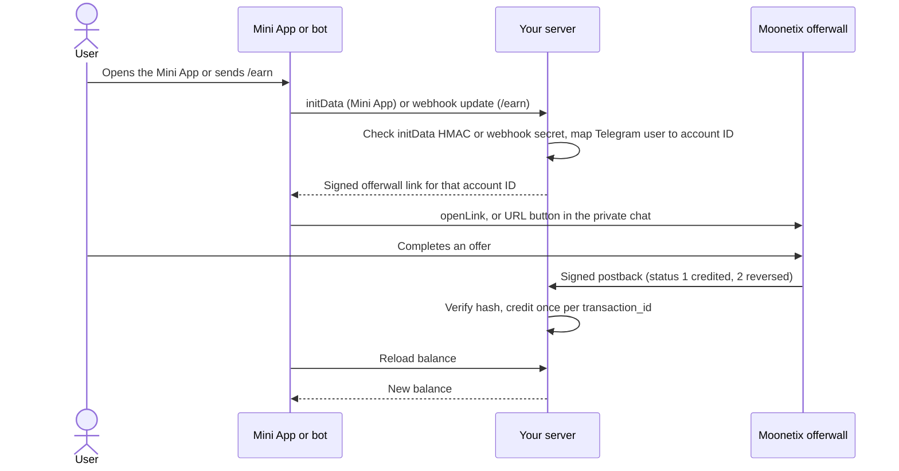

# Telegram Mini App Offerwall

**Let your Telegram users earn your coins by completing offers, with every reward verified on your own server.**

[](https://github.com/moonetix/telegram-mini-app-offerwall/actions/workflows/ci.yml)
[](LICENSE)
[](https://docs.moonetix.com/offerwall-link)
[](https://moonetix.com/register?from=github-telegram-mini-app-offerwall)
[](https://moonetix.com/academy/integrations/make-a-telegram-mini-app)
[](https://moonetix.com/industries/telegram)

A small Node.js server for a Telegram Mini App with the [Moonetix](https://moonetix.com) offerwall. It validates Telegram's `initData`, signs the offerwall link on the server, opens it with `Telegram.WebApp.openLink`, and credits coins from Moonetix postbacks. Moonetix is an affiliate network: your users earn your own currency by completing offers, and you earn per completed offer.

> **Get your App ID and keys: sign up free at https://moonetix.com/register?from=github-telegram-mini-app-offerwall**

## What it gets right

1. **Nothing to trust on the client.** The user comes only from `initData` your server validated with the bot token. The link salt and postback key never reach the Mini App.
2. **Balances that stay right.** Each `transaction_id` is credited once, a reversal takes back exactly what was credited, and the answer is 2xx only after the change is stored.
3. **Runs as is.** Node 22, no npm packages, SQLite built into Node, and 30 tests that check against real Moonetix link and postback vectors.

## How it fits together



## Quick start

You need Node.js 22.13 or later, a bot from [@BotFather](https://t.me/BotFather), an https host, and a Moonetix app.

```bash
git clone https://github.com/moonetix/telegram-mini-app-offerwall.git
cd telegram-mini-app-offerwall
cp .env.example .env      # fill in your bot token and Moonetix keys
npm start                 # serves the Mini App on PORT (default 3000)
npm run set-webhook       # once: webhook, /earn command, menu button
```

Then in the Moonetix dashboard:

1. Open Offerwalls, your offerwall, Integration, and copy the App ID and link hash salt into `.env`.
2. On the Postback page, copy the postback secret key into `.env` and save this postback URL:

```
https://YOUR_HOST/moonetix/postback?user={user_id}&tx={transaction_id}&event={event_id}&status={status}&reward={reward}&payout={payout}&offer={offer_name}&hash={hash}
```

Put the server behind https (a reverse proxy or your host's TLS). Telegram only opens Mini Apps and sends webhooks over https.

| Variable | Required | Default | What it is |
| --- | --- | --- | --- |
| `TELEGRAM_BOT_TOKEN` | yes | none | Your bot token. Validates `initData` and calls the Bot API. Server only. |
| `TELEGRAM_WEBHOOK_SECRET` | yes | none | 1 to 256 characters from `A-Z a-z 0-9 _ -`. Telegram sends it back in every webhook call. |
| `MOONETIX_APP_ID` | yes | none | App ID from the Integration section. |
| `MOONETIX_LINK_SALT` | yes | none | Link hash salt from the Integration section. |
| `MOONETIX_POSTBACK_KEY` | yes | none | Postback secret key from the Postback page. |
| `PUBLIC_URL` | for `set-webhook` | none | Public https address of this server. Also used for the Open the app button. |
| `PORT` | no | `3000` | HTTP port. |
| `DATABASE_PATH` | no | `./data.sqlite` | SQLite file. |
| `INIT_DATA_MAX_AGE` | no | `3600` | Oldest `initData` accepted, in seconds. |
| `CURRENCY_NAME` | no | `Coins` | Currency name shown in the Mini App and bot replies. |

## How it works

1. The Mini App (`public/`) loads `telegram-web-app.js` and sends the raw `Telegram.WebApp.initData` to `POST /api/session`.
2. The server validates it as Telegram documents: HMAC-SHA256 of the sorted data-check-string, with a key made from the bot token and `WebAppData`, plus an `auth_date` age check. `initDataUnsafe` is never used.
3. The Telegram user ID is mapped to an account ID in your database. The offerwall only ever sees that account ID, never the Telegram ID.
4. The user confirms they are 16 or older once. Until then no link is built.
5. `POST /api/offerwall-link` returns the signed link: HMAC-SHA256 of the account ID with your link hash salt. The page opens it with `Telegram.WebApp.openLink` when the user taps Earn, because `openLink` only works from a user action.
6. Optional: the bot answers `/earn` in the private chat with the same kind of signed link as a URL button. In groups it only says to ask in private.
7. Moonetix calls `GET /moonetix/postback`. The server checks the hash first, credits on status 1 once per `transaction_id`, takes the credited amount back on status 2, and answers 200 after the change is stored.
8. The Mini App reloads the balance when it becomes visible again, or when the user taps Refresh balance.

| Path | Purpose |
| --- | --- |
| `src/telegram.js` | `initData` validation |
| `src/moonetix.js` | Signed link, postback hash, exact amounts |
| `src/postback.js` | Postback handler |
| `src/store.js` | SQLite accounts, balances, transactions |
| `src/bot.js` | `/start` and `/earn` webhook replies |
| `src/server.js` | HTTP routes |
| `public/` | The Mini App page |
| `scripts/set-webhook.js` | Sets the webhook, command list and menu button |

## Security notes

- The bot token, link hash salt and postback secret key are read from environment variables on the server. Never put them in the Mini App or in Git.
- The account comes only from validated `initData`. A user ID the client sends is ignored.
- The postback hash is checked with a constant-time comparison before anything else. Tampered or wrongly signed postbacks get 403.
- `transaction_id` is the primary key of the transactions table, so a retry cannot credit twice. Credit and balance change run in one database transaction.
- A reversal subtracts the stored credited amount, only for a transaction that was credited to the same account. Balances can go below zero after a reversal; say in your terms that rewards can be taken back.
- Signed links are personal. They are sent only in the private chat or to the Mini App of that user. Never post one in a channel or group.
- The webhook checks `X-Telegram-Bot-Api-Secret-Token` with a constant-time comparison.
- Amounts are stored as integers in millionths of a coin, so decimal rewards like `0.375` add up exactly.
- Telegram user IDs can be larger than 32 bits, so they are stored as text.

## Rules to follow

- Rewards are only for completed offers. Never for joining a channel, inviting friends, reacting, reviews or any other engagement.
- Users must be 16 or older, with a parent's permission under 18.
- Publish a privacy policy in @BotFather that says IP address, device and offer activity reach the offerwall provider.
- Do not broadcast offers to everyone who pressed Start. Telegram's developer terms forbid spamming users.
- Coins or boosts you sell inside the Mini App must be paid in Telegram Stars. Earning through offers is not a sale.
- Do not link users to crypto that is not based on TON. Hide such offers on the Offers page of your dashboard.

Read the current [Telegram Bot Platform Developer Terms](https://telegram.org/tos/bot-developers) yourself before launch.

## Test it locally

```bash
npm test
```

The tests need no Telegram account and no network. They:

- sign `initData` with a local test token, then check that a valid payload passes and a changed user, changed `signature` field, changed or malformed hash, other bot token, old `auth_date` and missing user all fail;
- compare the signed link with a link produced by the Moonetix link code for the same test keys (`test/fixtures/moonetix-vectors.json`);
- start the server on a random port with an in-memory database and replay real Moonetix postbacks: credit, retry, decimal rewards, reversal, repeated reversal, reversal of an uncredited `test_` transaction, unknown users, and tampered or wrongly signed postbacks;
- check the webhook secret, that `/earn` sends a URL button only in private chats, and that it asks unconfirmed users to open the app first.

To check a deployed or local server from the outside, run [postback-tester](https://github.com/moonetix/postback-tester) against it. It signs postbacks the way Moonetix does and sends a credit and its retry, three kinds of reversal, four forged or unsigned postbacks and five parallel copies of one credit. Open the Mini App once first so account `1` exists:

```bash
export MOONETIX_POSTBACK_KEY=your-postback-secret-key   # same value as in .env
npx github:moonetix/postback-tester --preset moonetix \
  'http://localhost:3000/moonetix/postback?user={user_id}&tx={transaction_id}&event={event_id}&status={status}&reward={reward}&payout={payout}&offer={offer_name}&hash={hash}' --user 1
```

## Test it with Moonetix

1. Open the Mini App from a test Telegram account. Your account gets ID 1 on a fresh database.
2. In the dashboard, open Offerwalls, your offerwall, Integration. Under Integration status, use Check a link and compare Test a link for user ID `1` with the link your server returns.
3. Click Send a test postback with user ID `1` and status 1. This server credits test postbacks for real account IDs, so the balance in the Mini App goes up once. A retry of the same transaction changes nothing.
4. A status 2 test gets a new `test_` transaction ID that was never credited, so the server answers 200 and changes nothing. The Postback page has the same test sender.
5. Open the offerwall from a normal home or mobile connection. VPNs, proxies, Tor and data center networks see a block page.
6. Before launch, remove the test rewards from your test account.

## Common problems

| What you see | Why, and the fix |
| --- | --- |
| `node: .env: not found` on `npm start` | `npm start` reads `.env` from the repo root. Run `cp .env.example .env` and fill it in. |
| `Missing environment variables: ...` | One of the five required variables is empty. The message lists which. |
| `Set TELEGRAM_BOT_TOKEN, TELEGRAM_WEBHOOK_SECRET and an https PUBLIC_URL first.` | `npm run set-webhook` needs an `https://` `PUBLIC_URL`. Telegram rejects plain http. |
| Page says "Open this app from Telegram." | It was opened in a normal browser, so there is no `initData`. Open it from the bot's menu button. |
| `/api/session` answers `403 invalid_init_data` | `TELEGRAM_BOT_TOKEN` belongs to another bot, or `initData` is older than `INIT_DATA_MAX_AGE`. |
| `/earn` gets no reply, webhook calls answer `401` | `TELEGRAM_WEBHOOK_SECRET` changed after `set-webhook`. Run `npm run set-webhook` again. |
| Postback answers `403 invalid hash`, or `200 ignored: unknown user` | Wrong `MOONETIX_POSTBACK_KEY`; or the user ID is not one of your account IDs (`test_user`, for example). Account IDs start at 1. |

## Learn more

- Guide: [Add an Offerwall to a Telegram Mini App](https://moonetix.com/academy/integrations/telegram-mini-app-offerwall)
- Guide: [How to Make a Telegram Mini App](https://moonetix.com/academy/integrations/make-a-telegram-mini-app)
- Moonetix for Telegram: [moonetix.com/industries/telegram](https://moonetix.com/industries/telegram)
- Docs: [Offerwall link](https://docs.moonetix.com/offerwall-link), [Postbacks](https://docs.moonetix.com/postbacks), [Credits and reversals](https://docs.moonetix.com/credits-and-reversals), [Testing](https://docs.moonetix.com/testing)
- Free tools: [Offerwall link builder](https://moonetix.com/tools/offerwall-link-builder) and [Postback hash checker](https://moonetix.com/tools/postback-hash-checker)

## Get started

**Get your App ID and keys: sign up free at https://moonetix.com/register?from=github-telegram-mini-app-offerwall**

Every publisher application is reviewed by hand. Once you are approved, add your Mini App as an app, set your coin name and rate, and paste the keys into `.env`.

## More Moonetix examples

- **Start here:** [awesome-offerwalls](https://github.com/moonetix/awesome-offerwalls), [offerwall-postback-handlers](https://github.com/moonetix/offerwall-postback-handlers)
- **Web and backends:** [offerwall-nextjs-starter](https://github.com/moonetix/offerwall-nextjs-starter), [offerwall-react-vite](https://github.com/moonetix/offerwall-react-vite), [offerwall-vue-nuxt](https://github.com/moonetix/offerwall-vue-nuxt), [offerwall-express](https://github.com/moonetix/offerwall-express), [offerwall-laravel](https://github.com/moonetix/offerwall-laravel), [offerwall-django](https://github.com/moonetix/offerwall-django), [offerwall-firebase-functions](https://github.com/moonetix/offerwall-firebase-functions), [offerwall-supabase](https://github.com/moonetix/offerwall-supabase), [rewards-site-starter](https://github.com/moonetix/rewards-site-starter), [moonetix-offerwall-wordpress](https://github.com/moonetix/moonetix-offerwall-wordpress)
- **Apps and games:** [offerwall-flutter-example](https://github.com/moonetix/offerwall-flutter-example), [offerwall-unity-example](https://github.com/moonetix/offerwall-unity-example), [offerwall-godot](https://github.com/moonetix/offerwall-godot)
- **Communities and desktop:** [discord-rewards-bot](https://github.com/moonetix/discord-rewards-bot), [offerwall-chrome-extension](https://github.com/moonetix/offerwall-chrome-extension)
- **Tools and data:** [postback-tester](https://github.com/moonetix/postback-tester), [signup-guard](https://github.com/moonetix/signup-guard), [datacenter-ip-ranges](https://github.com/moonetix/datacenter-ip-ranges), [reward-economy-kit](https://github.com/moonetix/reward-economy-kit), [referral-engine](https://github.com/moonetix/referral-engine), [gamification-kit](https://github.com/moonetix/gamification-kit), [offerwall-fraud-playbook](https://github.com/moonetix/offerwall-fraud-playbook), [affiliate-postback-macros](https://github.com/moonetix/affiliate-postback-macros), [country-tiers](https://github.com/moonetix/country-tiers)

## License

MIT. See [LICENSE](LICENSE).
